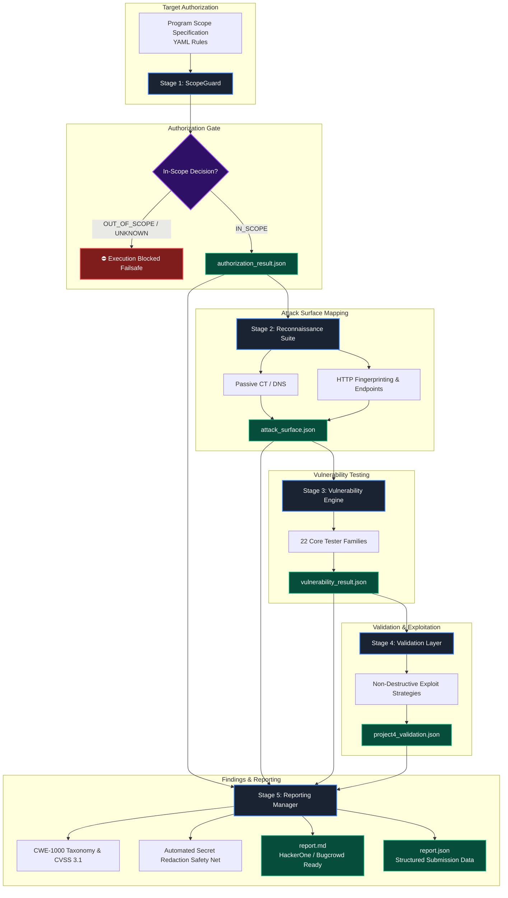

# Hunt_Chain

<div align="center">

```text
      __  __ __  __ _   __ ______      ______ __  __ ___     ____ _   __
     / / / // / / // | / //_  __/     / ____// / / //   |   /  _// | / /
    / /_/ // / / //  |/ /  / /   ─── / /    / /_/ // /| |   / / /  |/ / 
   / __  // /_/ // /|  /  / /       / /___ / __  // ___ | _/ / / /|  /  
  /_/ /_/ \____//_/ |_/  /_/        \____//_/ /_//_/  |_|/___//_/ |_/   
```

**Authorized Security Testing & Vulnerability Orchestration Framework**  
*From Target Authorization to Triager-Ready Bug Bounty Reports*

[](https://github.com/Atharva-g19/Hunt_Chain/actions/workflows/ci.yml)


</div>

---

## Overview

**Hunt_Chain** is a modular cybersecurity workflow engine built for authorized penetration testers, bug bounty researchers, and AppSec teams. 

Instead of an opaque, monolithic scanner that blunders into out-of-scope assets or generates unverified findings, Hunt_Chain operates as a **strictly gated pipeline of 5 focused engines**. Each stage enforces hard boundaries and produces structured, reproducible JSON and Markdown artifacts consumed by subsequent stages.

The entire workflow starts with the primary rule of offensive security:
> **"Are we authorized to test this target?"**

---

## Architecture & Pipeline Workflow



---

## The 5 Pipeline Stages

### 1. ScopeGuard (Target Authorization Gate)
- **Zero-Trust Scope Enforcement**: Parses program scope rules (exact URLs, path prefixes, wildcard domains, excluded endpoints).
- **Failsafe Gating**: Rejects out-of-scope targets before any network probe is launched. Produces cryptographically structured `authorization_result.json`.

### 2. Reconnaissance & Attack Surface Engine
- **Passive & Active Asset Discovery**: Certificate Transparency logs, DNS resolution (A, AAAA, CNAME), wildcard DNS detection, and dangling CNAME checks.
- **Controlled HTTP Observation**: Inspects status codes, headers, server signatures, and extracted endpoints while respecting scope filters.

### 3. Vulnerability Testing Toolkit (22 Families)
Automated testing across 22 comprehensive vulnerability families:

| # | Vulnerability Family | CWE | Description |
|:---:|:---|:---:|:---|
| 01 | **SQL Injection (SQLi)** | CWE-89 | In-band, boolean, error-based, time-based, and out-of-band injection probes |
| 02 | **Cross-Site Scripting (XSS)** | CWE-79 | Reflected, DOM-based, and context-aware HTML/attribute injection |
| 03 | **Server-Side Request Forgery (SSRF)** | CWE-918 | Cloud metadata, internal IP schemes, IPv6/decimal bypasses, parser differentials |
| 04 | **IDOR / BOLA** | CWE-639 | Broken object-level authorization & parameter identifier tampering |
| 05 | **Broken Function Level Authorization** | CWE-285 | Horizontal and vertical privilege escalation across role endpoints |
| 06 | **Remote Code Execution (RCE)** | CWE-78 | OS command injection, argument injection, and shell metacharacter bypasses |
| 07 | **Path Traversal & Arbitrary Upload** | CWE-22 | Directory traversal, null-byte bypasses, nested normalization stripping |
| 08 | **Authentication Bypass** | CWE-287 | Header spoofing, password reset flaws, default credential sets |
| 09 | **Account Takeover (ATO)** | CWE-284 | Session tampering, OAuth redirect poisoning, credential stuffing indicators |
| 10 | **XML External Entity (XXE)** | CWE-611 | Out-of-band XXE, file disclosure, parameter entity expansion |
| 11 | **Cross-Origin Resource Sharing (CORS)** | CWE-346 | Origin reflection, null origin trust, insecure sub-domain wildcards |
| 12 | **Cross-Site Request Forgery (CSRF)** | CWE-352 | Missing token validation, SameSite lax/none bypasses, method alteration |
| 13 | **Open Redirect** | CWE-601 | Parameter-based and path-based external redirect normalization bypasses |
| 14 | **Security Misconfiguration** | CWE-16 | Directory listing, debug mode exposure, sensitive default configurations |
| 15 | **Information Disclosure** | CWE-200 | Stack trace leaks, source map exposures, internal IP disclosures |
| 16 | **Sensitive Data Exposure** | CWE-312 | Unencrypted PII, secrets leakage, API tokens in response bodies |
| 17 | **Business Logic Flaws** | CWE-840 | Workflow sequencing, negative price/quantity tampering, rate limit evasion |
| 18 | **Broken Object Property Authorization** | CWE-915 | Mass assignment, parameter pollution, unexpected property injection |
| 19 | **Improper Inventory Management** | CWE-1059 | Deprecated/shadow API endpoints, unversioned API routes, undocumented hosts |
| 20 | **Subdomain Takeover** | CWE-403 | Dangling DNS CNAME records mapped to unclaimed cloud/SaaS providers |
| 21 | **Clickjacking** | CWE-1021 | Missing or misconfigured X-Frame-Options and Content-Security-Policy frame-ancestors |
| 22 | **Third-Party API Vulnerabilities** | CWE-1059 | External webhook validation flaws, unauthenticated gateway routes |

### 4. Validation & Exploitation Layer
- **Controlled Validation**: Validates candidate findings from Project 3 using safe, non-destructive validation strategies.
- **Proof-of-Exploit Generation**: Captures verified HTTP requests, response headers, and extraction tokens without mutating target databases or executing destructive commands.

### 5. Findings & Reporting Manager
- **Triager-Ready Formatting**: Formats findings to match the exact intake fields expected by platforms like **HackerOne** and **Bugcrowd**.
- **CVSS 3.1 & CWE-1000 Categorization**: Calculates accurate base severity vectors, impact/exploitability metrics, and remediation guidance.
- **Fail-Loud Redaction Safety Net**: Scans reports before write, automatically redacting live secrets (AWS keys, GitHub PATs, Stripe tokens, private API credentials).

---

## Cross-Platform Compatibility

Hunt_Chain is engineered to run seamlessly on **Linux (Ubuntu, Debian, Kali, Arch)**, **macOS**, and **Windows**:

- **Unified Path Resolution**: Standardized on `pathlib.Path` with zero hardcoded backslashes or drive letters.
- **Line Ending Enforcement**: Repository-wide `.gitattributes` guarantees LF line endings on checkout across all platforms.
- **UTF-8 Clean**: Completely sanitized of Windows UTF-8 Byte Order Marks (BOM), ensuring pristine command-line parsing and shebang compatibility.
- **Subprocess Safety**: All background invocations use `sys.executable` with argument vectors, preventing shell-injection and command-chaining syntax discrepancies.
- **Secure File Permissions**: Enforces `0o700` directory and `0o600` file permissions on POSIX systems for sensitive session tokens and report artifacts.
- **Automated Multi-OS CI**: Tested continuously across `ubuntu-latest`, `macos-latest`, and `windows-latest` via GitHub Actions.

---

## Getting Started

### Prerequisites
- Python 3.11, 3.12, or 3.13
- Git

### Installation

```bash
# 1. Clone the repository
git clone https://github.com/Atharva-g19/Hunt_Chain.git
cd Hunt_Chain

# 2. Create and activate a virtual environment
python -m venv .venv

# On Linux / macOS:
source .venv/bin/activate

# On Windows:
.venv\Scripts\activate

# 3. Install core dependencies
pip install --upgrade pip
pip install pytest pyyaml rich requests pydantic urllib3
```

### Launching the Interactive Console

```bash
python -m hunt_chain_core
```

This opens the interactive Hunt_Chain Navigation Console:

```text
Hunt_Chain Navigation Console
╭──────────┬────────────────────────────┬─────────────────────────────────────────────────────────────╮
│     [1]  │  New Assessment            │  Initialize a target scope & assessment run                 │
│     [2]  │  Open Assessment           │  Launch security pipeline for an existing project           │
│     [3]  │  List Assessments          │  Show all registered assessments and their pipeline status  │
│     [4]  │  Assessment Details        │  Executive dashboard & artifact inspection                  │
│     [0]  │  Exit                      │  Exit Hunt_Chain framework                                  │
╰──────────┴────────────────────────────┴─────────────────────────────────────────────────────────────╯
hunt-chain>
```

---

## Running Test Suites

Hunt_Chain comes with extensive unit, integration, and regression test suites across all 5 projects:

```bash
# ScopeGuard (Project 1)
python -m pytest "Project 1/ScopeGuard/tests" -v

# Reconnaissance Suite (Project 2)
python -m pytest "Project 2/tests" -v

# Vulnerability Engine & 22 Families (Project 3)
python -m pytest "Project_3_Vulnerability/tests" -v

# Validation & Exploitation Layer (Project 4)
python -m pytest "Project_4_Validation_Exploitation/tests" -v

# Reporting Manager (Project 5)
python -m pytest "Project_5_Reporting/tests" -v

# Core Orchestrator Integration
python -m pytest tests_hunt_chain -v
```

---

## License

This project is licensed under the [MIT License](LICENSE).